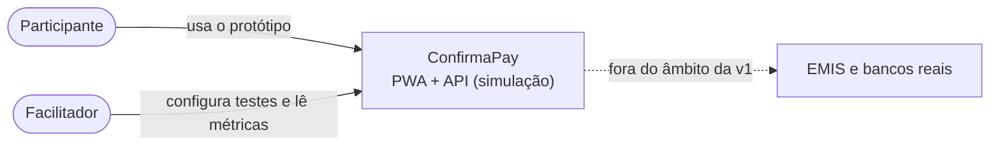
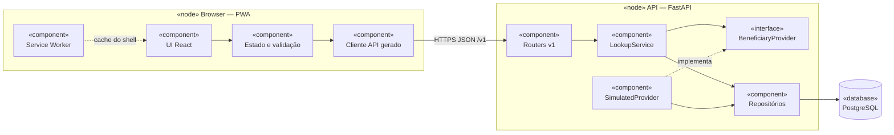
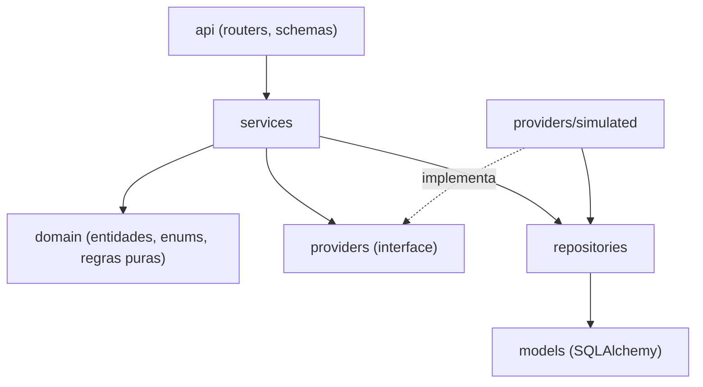
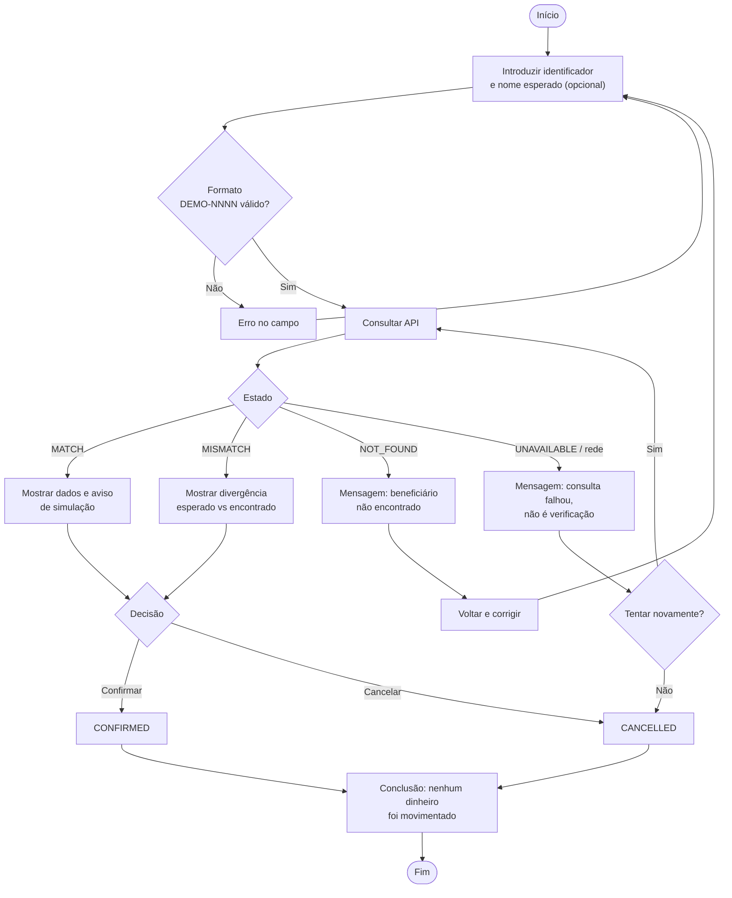

# 01 — Arquitectura

← [Índice](00-indice.md)

## 1. Princípios

1. **Estado explícito.** Toda a consulta termina num de quatro estados (`MATCH`, `MISMATCH`, `NOT_FOUND`, `UNAVAILABLE`). Falha nunca é sucesso (ADR-05).
2. **Provider substituível.** A origem dos dados está atrás de uma interface (ADR-03).
3. **Privacidade por construção.** Só `DEMO-NNNN`; nomes introduzidos pelo participante não são persistidos (ADR-06, ADR-09).
4. **Contrato primeiro.** O OpenAPI gerado pela API é a fonte de verdade (ADR-04).
5. **Simulação sempre visível.** Cada ecrã e cada resposta da API identificam-se como simulação (RF-09).

## 2. Contexto do sistema



## 3. Componentes



| Componente | Responsabilidade |
|---|---|
| UI React | Ecrãs, estados visuais, acessibilidade, banner de simulação |
| Estado e validação | Formulários (React Hook Form + Zod), cache de pedidos (TanStack Query) |
| Cliente API gerado | Tipos e chamadas a partir de `openapi.json` |
| Service Worker | Pré-cache do shell; nunca guarda respostas `/v1/*` |
| Routers v1 | Validação de entrada (Pydantic), mapeamento HTTP, erros `problem+json` |
| LookupService | Regras de negócio: timeout, estado, comparação de nomes, decisões permitidas |
| BeneficiaryProvider | Contrato de resolução de identificadores |
| SimulatedProvider | Resolve contra a tabela `beneficiaries` e simula latência e falha |
| Repositórios | Acesso a dados (SQLAlchemy) |

## 4. Camadas e regra de dependência (back-end)



Regras:

- As setas só apontam para baixo; `domain` não importa FastAPI nem SQLAlchemy.
- Routers não contêm regras de negócio.
- Só `services` conhece o timeout do provider.
- Só `providers/simulated` conhece o identificador de falha (`DEMO-9999`).

## 5. Fluxo principal (diagrama de actividade)



## 6. Requisitos não funcionais

| ID | Requisito | Verificação |
|---|---|---|
| NFR-01 | `POST /v1/lookups` com p95 ≤ 300 ms, excluindo a latência simulada | Teste de carga local (05, TC-22) |
| NFR-02 | Timeout do provider de 2 s; ao exceder, estado `UNAVAILABLE` | TC-08 |
| NFR-03 | Zero dados pessoais reais; `expected_name` não persistido nem registado em logs | TC-02, TC-15 |
| NFR-04 | Acessibilidade WCAG 2.2 AA nos ecrãs do fluxo; sem violações críticas no axe | TC-17 |
| NFR-05 | Lighthouse móvel ≥ 90 em Desempenho e PWA | TC-18 |
| NFR-06 | Disponibilidade da demo em regime de melhor esforço, com health check | TC-23 |
| NFR-07 | `request_id` em todos os logs e respostas de erro | TC-16 |
| NFR-08 | Trocar o provider sem alterar router, serviço ou UI | TC-19 |
| NFR-09 | Contrato OpenAPI versionado; CI falha se divergir do código | CI (04 §5) |

## 7. Stack

| Camada | Escolha |
|---|---|
| Front-end | React 18, Vite, TypeScript (strict), Tailwind CSS, React Router, TanStack Query, React Hook Form + Zod |
| Contrato | `openapi-typescript` + `openapi-fetch` (tipos e cliente gerados) |
| PWA | `vite-plugin-pwa` (Workbox) |
| Back-end | Python 3.12, FastAPI, Pydantic v2, Uvicorn, SQLAlchemy 2 (async), Alembic, psycopg 3 |
| Back-end (suporte) | `slowapi` (rate limit), `structlog` (logs JSON) |
| Dados | PostgreSQL ≥ 16 |
| Gestão de dependências | `pnpm` (Node LTS ≥ 22) e `uv` (Python) |
| Testes | Vitest, Testing Library, MSW, Playwright, `@axe-core/playwright`, Lighthouse CI, Pytest, httpx, pytest-asyncio, pytest-cov |
| Qualidade | ESLint, Prettier, Ruff, mypy, `pip-audit` |
| Infra | Docker, Docker Compose, GitHub Actions, Vercel (web), Render (API e Postgres) |
| Design | Figma |

Alterações face à Etapa 1: SQLite removido (ADR-02); acrescentados `uv`, `pnpm`, `openapi-typescript`, `vite-plugin-pwa`, MSW, `slowapi`, `structlog`.

## 8. Estrutura do monorepo

```
confirmapay/
├── README.md
├── docs/technical/              # esta documentação
├── apps/
│   ├── api/
│   │   ├── app/
│   │   │   ├── main.py
│   │   │   ├── config.py
│   │   │   ├── api/v1/          # health, scenarios, test_runs, lookups, admin
│   │   │   ├── schemas/         # modelos Pydantic (pedido/resposta)
│   │   │   ├── services/        # LookupService, MetricsService
│   │   │   ├── domain/          # enums, comparação de nomes, máscara
│   │   │   ├── providers/       # base.py, simulated.py
│   │   │   ├── repositories/
│   │   │   ├── models/          # SQLAlchemy
│   │   │   ├── core/            # errors, logging, security, request_id
│   │   │   ├── scenarios.py     # catálogo SC-01..SC-06
│   │   │   └── seed/
│   │   ├── migrations/
│   │   ├── tests/
│   │   ├── openapi.json         # gerado e versionado
│   │   └── pyproject.toml
│   └── web/                     # estrutura em 03-frontend.md
├── docker-compose.yml
├── Makefile
└── .github/workflows/
```
