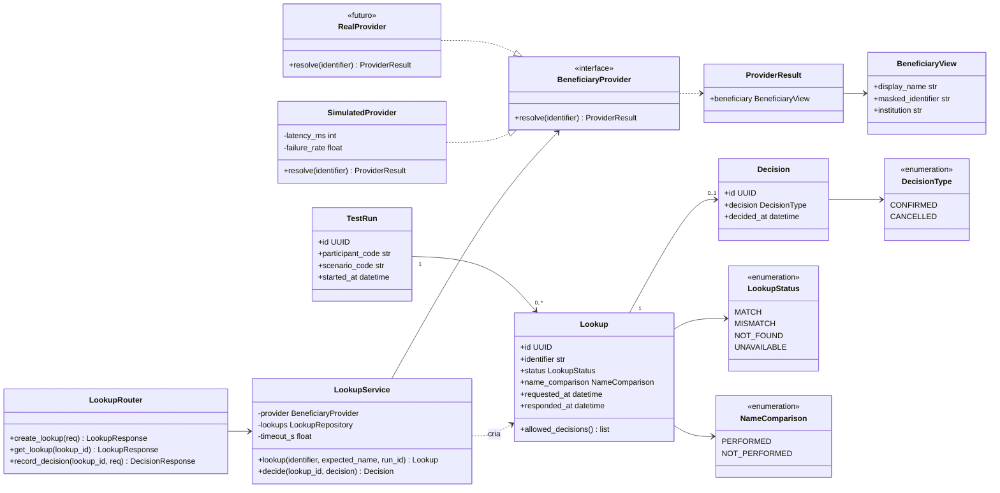
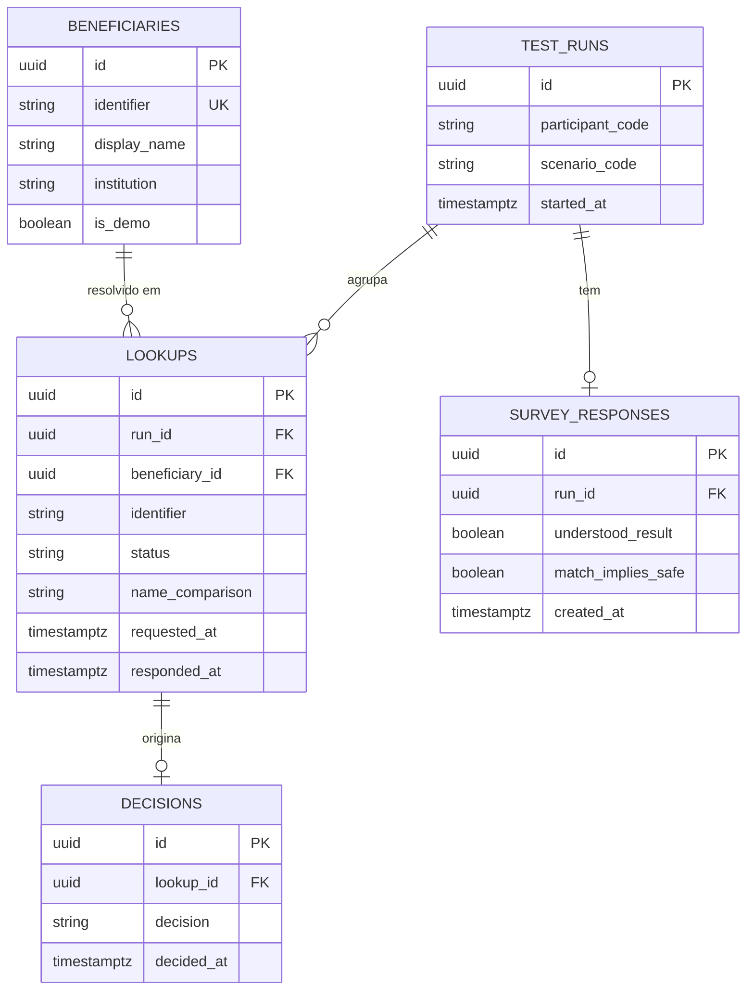
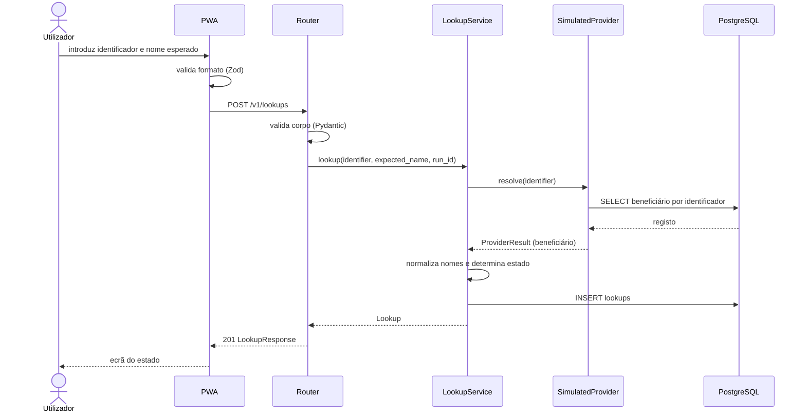
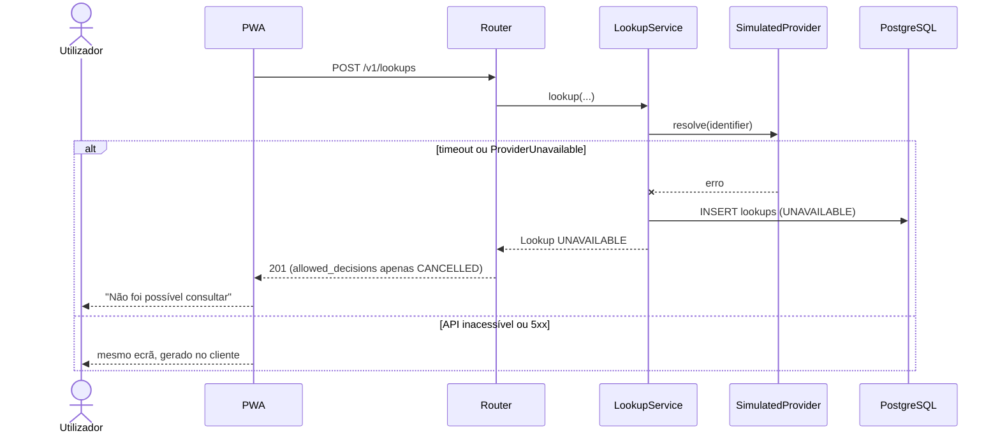
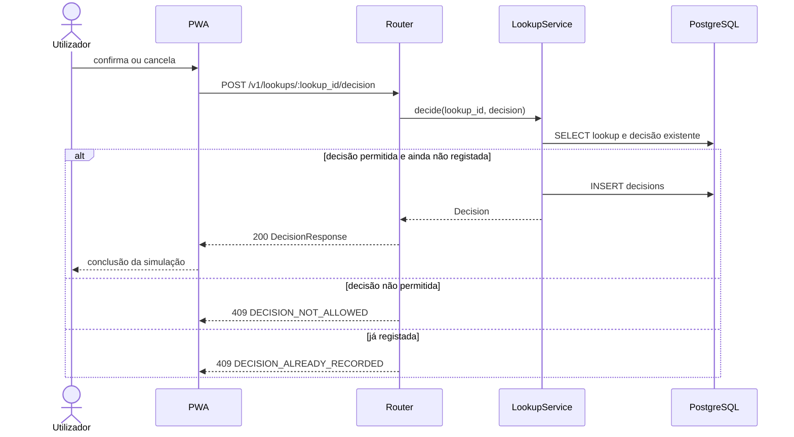
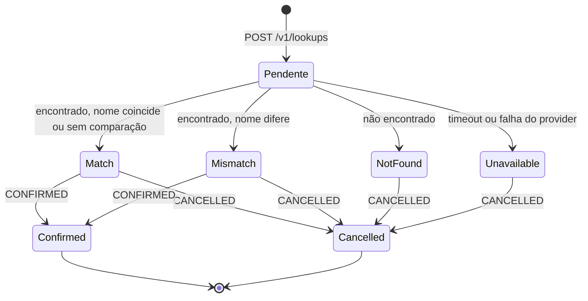

# 02 — Back-end

← [Índice](00-indice.md) · [Arquitectura](01-arquitectura.md)

## 1. Modelo de domínio



## 2. Modelo de dados



Restrições:

| Tabela | Restrição |
|---|---|
| `beneficiaries` | `identifier` único, `CHECK (identifier ~ '^DEMO-[0-9]{4}$')`, `CHECK (is_demo = true)` |
| `lookups` | `status IN ('MATCH','MISMATCH','NOT_FOUND','UNAVAILABLE')`; `beneficiary_id` nulo quando `NOT_FOUND` ou `UNAVAILABLE`; índice em `run_id` |
| `decisions` | `lookup_id` único (uma decisão por consulta); `decision IN ('CONFIRMED','CANCELLED')` |
| `survey_responses` | `run_id` único |
| `test_runs` | `participant_code` com `CHECK (participant_code ~ '^P-[0-9]{3}$')` |

Todas as chaves primárias são UUID v4 geradas na aplicação. Todos os instantes em UTC.

## 3. Contrato da API (v1)

Base: `/v1`. Formato: JSON UTF-8. Documentação interactiva em `/docs` (Swagger) e `openapi.json` versionado em `apps/api/openapi.json`.

| Método | Rota | Autenticação | Sucesso | Erros |
|---|---|---|---|---|
| GET | `/v1/health` | — | 200 | 503 |
| GET | `/v1/scenarios` | — | 200 | — |
| POST | `/v1/test-runs` | — | 201 | 404 `SCENARIO_NOT_FOUND`, 422 |
| POST | `/v1/lookups` | — | 201 | 404 `RUN_NOT_FOUND`, 422, 429 |
| GET | `/v1/lookups/:lookup_id` | — | 200 | 404 `LOOKUP_NOT_FOUND` |
| POST | `/v1/lookups/:lookup_id/decision` | — | 200 | 404, 409 `DECISION_NOT_ALLOWED`, 409 `DECISION_ALREADY_RECORDED`, 422 |
| POST | `/v1/test-runs/:run_id/survey` | — | 201 | 404 `RUN_NOT_FOUND`, 409 `SURVEY_ALREADY_RECORDED`, 422 |
| GET | `/v1/admin/metrics` | `X-Admin-Key` | 200 | 401 |
| GET | `/v1/admin/export.csv` | `X-Admin-Key` | 200 | 401 |

Todas as respostas incluem `Cache-Control: no-store` e o cabeçalho `X-Request-ID`.

### 3.1 `POST /v1/lookups`

Pedido:

```json
{
  "identifier": "DEMO-1001",
  "expected_name": "Maria Exemplo Teste",
  "run_id": "5f0c6c1e-9c1e-4b7e-8a53-2f4f6f0c9a11"
}
```

| Campo | Tipo | Regras |
|---|---|---|
| `identifier` | string | Obrigatório. Após `trim` e maiúsculas: `^DEMO-\d{4}$` |
| `expected_name` | string | Opcional. 1–120 caracteres após `trim`; sem caracteres de controlo |
| `run_id` | UUID | Opcional. Associa a consulta a uma execução de teste |

Resposta `201` (estado `MATCH`, com comparação):

```json
{
  "lookup_id": "b1d1f9c4-3d6e-4f0e-9d1b-0a4b8a1d7e22",
  "status": "MATCH",
  "name_comparison": "PERFORMED",
  "beneficiary": {
    "display_name": "Maria Exemplo Teste",
    "masked_identifier": "DEMO-***1",
    "institution": "Banco Demo A"
  },
  "expected_name": "Maria Exemplo Teste",
  "allowed_decisions": ["CONFIRMED", "CANCELLED"],
  "is_simulation": true,
  "disclaimer": "Simulação com dados fictícios. Nenhum dinheiro é movimentado.",
  "requested_at": "2026-10-17T11:00:00.120Z",
  "responded_at": "2026-10-17T11:00:00.540Z"
}
```

Variações por estado:

| Estado | `beneficiary` | `name_comparison` | `allowed_decisions` |
|---|---|---|---|
| `MATCH` | preenchido | `PERFORMED` se houve `expected_name`, senão `NOT_PERFORMED` | `CONFIRMED`, `CANCELLED` |
| `MISMATCH` | preenchido | `PERFORMED` | `CONFIRMED`, `CANCELLED` |
| `NOT_FOUND` | `null` | `NOT_PERFORMED` | `CANCELLED` |
| `UNAVAILABLE` | `null` | `NOT_PERFORMED` | `CANCELLED` |

Notas:

- `expected_name` é devolvido apenas na resposta do `POST`, copiado do pedido. Não é guardado; `GET /v1/lookups/:id` não o devolve. O cliente guarda-o em `sessionStorage` se precisar dele após recarregar a página.
- `allowed_decisions` é a fonte de verdade para o cliente decidir que botões mostrar.
- O estado `UNAVAILABLE` é devolvido com HTTP 201: a consulta foi registada e o resultado é uma falha explícita. Falhas da própria API (5xx) são tratadas pelo cliente como `UNAVAILABLE` local (03 §7).

### 3.2 `GET /v1/lookups/:lookup_id`

Devolve o mesmo corpo de 3.1, sem `expected_name`, mais o campo `decision` (`null` ou `{ "decision": "...", "decided_at": "..." }`). Serve para restaurar o ecrã de resultado após recarregar a página.

### 3.3 `POST /v1/lookups/:lookup_id/decision`

```json
{ "decision": "CONFIRMED" }
```

Resposta `200`:

```json
{
  "lookup_id": "b1d1f9c4-3d6e-4f0e-9d1b-0a4b8a1d7e22",
  "decision": "CONFIRMED",
  "decided_at": "2026-10-17T11:00:07.001Z",
  "is_simulation": true,
  "message": "Simulação concluída. Nenhum dinheiro foi movimentado."
}
```

### 3.4 `GET /v1/scenarios`

Devolve os campos visíveis ao participante. `expected_decision` e `expected_status` nunca são expostos.

```json
[
  {
    "code": "SC-02",
    "title": "Nome diferente do esperado",
    "instruction": "Pretende transferir para Joana Fictícia Santos. Use o identificador DEMO-1002.",
    "identifier": "DEMO-1002",
    "expected_name": "Joana Fictícia Santos"
  }
]
```

### 3.5 `POST /v1/test-runs`

Pedido: `{ "participant_code": "P-007", "scenario_code": "SC-02" }`.
Resposta `201`: `{ "run_id": "...", "scenario": { ...como em 3.4... }, "started_at": "..." }`.

### 3.6 `POST /v1/test-runs/:run_id/survey`

Pedido: `{ "understood_result": true, "match_implies_safe": false }`. Resposta `201`: `{ "run_id": "...", "recorded": true }`.

### 3.7 `GET /v1/admin/metrics`

Agrega por cenário (definições em 05 §6):

```json
{
  "generated_at": "2026-10-17T12:00:00Z",
  "scenarios": [
    {
      "code": "SC-02",
      "runs": 12,
      "runs_with_decision": 12,
      "correct_decision_rate": 0.83,
      "task_time_ms": { "median": 9400, "p90": 14200 },
      "survey": { "responses": 12, "understood_result_rate": 0.92, "match_implies_safe_rate": 0.17 }
    }
  ]
}
```

`GET /v1/admin/export.csv`: uma linha por execução com `run_id, participant_code, scenario_code, status, decision, expected_decision, correct, task_time_ms, understood_result, match_implies_safe`.

## 4. Regras de negócio

### 4.1 Determinação do estado

1. Validar formato do identificador (422 `IDENTIFIER_FORMAT_INVALID` se inválido).
2. Chamar `provider.resolve(identifier)` com timeout de `PROVIDER_TIMEOUT_S` (2 s por omissão).
3. `ProviderUnavailable` ou timeout → `UNAVAILABLE`.
4. `beneficiary = None` → `NOT_FOUND`.
5. Sem `expected_name` → `MATCH` com `name_comparison = NOT_PERFORMED`.
6. Com `expected_name`: normalizar ambos os nomes; iguais → `MATCH`, `PERFORMED`; diferentes → `MISMATCH`, `PERFORMED`.

### 4.2 Normalização de nomes

`NFKD` → remover marcas combinantes (acentos) → `casefold` → colapsar espaços → `strip`. A comparação é igualdade exacta após normalização. Correspondência aproximada fica fora da v1 (README §6 define quatro resultados).

### 4.3 Máscara do identificador

Mantém o prefixo `DEMO-` e o último dígito: `DEMO-1001` → `DEMO-***1`.

### 4.4 Decisões permitidas

| Estado | `CONFIRMED` | `CANCELLED` |
|---|---|---|
| `MATCH` | Sim | Sim |
| `MISMATCH` | Sim | Sim |
| `NOT_FOUND` | Não | Sim |
| `UNAVAILABLE` | Não | Sim |

Violação → 409 `DECISION_NOT_ALLOWED`. Segunda decisão sobre a mesma consulta → 409 `DECISION_ALREADY_RECORDED`.

## 5. Sequências

### 5.1 Consulta bem-sucedida



### 5.2 Consulta indisponível



### 5.3 Registo de decisão



## 6. Ciclo de vida da consulta



`Pendente` é transitório e existe só em memória durante o pedido. A linha em `lookups` é inserida já com o estado final.

## 7. Provider

```python
from dataclasses import dataclass
from typing import Protocol


@dataclass(frozen=True)
class BeneficiaryView:
    display_name: str
    masked_identifier: str
    institution: str


@dataclass(frozen=True)
class ProviderResult:
    beneficiary: BeneficiaryView | None  # None = não encontrado


class ProviderUnavailable(Exception):
    """Falha de infra-estrutura do provider. Nunca significa 'não encontrado'."""


class BeneficiaryProvider(Protocol):
    async def resolve(self, identifier: str) -> ProviderResult: ...
```

Regras do contrato:

- `resolve` devolve `beneficiary=None` só quando o provider respondeu e o identificador não existe.
- Qualquer falha de comunicação lança `ProviderUnavailable`. Nunca devolve dados inventados.
- O timeout pertence ao `LookupService`, não ao provider.
- Todos os providers passam a mesma suite de testes de contrato (05, TC-19).

### 7.1 SimulatedProvider

| Comportamento | Origem |
|---|---|
| Latência artificial | `SIMULATED_LATENCY_MS` (por omissão 400) |
| Falha determinística | Identificador `DEMO-9999` lança `ProviderUnavailable` |
| Falha aleatória | `SIMULATE_FAILURE_RATE` (por omissão 0.0) |
| Dados | Tabela `beneficiaries` |

## 8. Erros (`application/problem+json`)

```json
{
  "type": "https://confirmapay.example/problems/identifier-format-invalid",
  "title": "Identificador inválido",
  "status": 422,
  "detail": "Use um identificador de demonstração no formato DEMO-NNNN.",
  "code": "IDENTIFIER_FORMAT_INVALID",
  "request_id": "9a1f..."
}
```

| `code` | HTTP | Situação |
|---|---|---|
| `VALIDATION_ERROR` | 422 | Corpo ou parâmetros inválidos |
| `IDENTIFIER_FORMAT_INVALID` | 422 | Identificador fora de `DEMO-NNNN` |
| `SCENARIO_NOT_FOUND` | 404 | Código de cenário desconhecido |
| `RUN_NOT_FOUND` | 404 | `run_id` inexistente |
| `LOOKUP_NOT_FOUND` | 404 | `lookup_id` inexistente |
| `DECISION_NOT_ALLOWED` | 409 | Decisão não permitida para o estado |
| `DECISION_ALREADY_RECORDED` | 409 | Já existe decisão |
| `SURVEY_ALREADY_RECORDED` | 409 | Já existe inquérito para a execução |
| `UNAUTHORIZED` | 401 | Chave de administração ausente ou errada |
| `RATE_LIMITED` | 429 | Limite de pedidos excedido |
| `INTERNAL_ERROR` | 500 | Erro não previsto (sem detalhes internos) |

O domínio `confirmapay.example` em `type` é um marcador; substituir pelo domínio real (Q-06).

## 9. Segurança e privacidade

| Tema | Regra |
|---|---|
| Dados | Só `DEMO-NNNN`; `expected_name` não é persistido nem registado em logs |
| CORS | Lista de origens em `CORS_ORIGINS`; sem `*` |
| Rate limit | `RATE_LIMIT` (por omissão 60/minuto por IP) com `slowapi`; excedido → 429 |
| Administração | `X-Admin-Key` comparada em tempo constante; se `ADMIN_API_KEY` não estiver definida, os endpoints `/v1/admin/*` ficam desactivados (404) |
| Cabeçalhos | `Cache-Control: no-store`, `X-Content-Type-Options: nosniff`, `Referrer-Policy: no-referrer` |
| Logs | JSON (`structlog`) com `request_id`, método, rota, estado, duração; nunca corpos de pedido |
| Dependências | `pip-audit` no CI |
| Cookies / sessões | Nenhuma |
| Limites de entrada | Corpo máximo 4 KB; `expected_name` ≤ 120 caracteres |

## 10. Dados de seed e cenários

Nomes e instituições são fictícios e devem ser aprovados (Q-03).

| Identificador | Nome | Instituição |
|---|---|---|
| `DEMO-1001` | Maria Exemplo Teste | Banco Demo A |
| `DEMO-1002` | João Fictício Santos | Banco Demo B |
| `DEMO-1003` | Empresa Demo Lda | Banco Demo A |
| `DEMO-1004` | Ana Simulada Costa | Banco Demo C |
| `DEMO-1005` | Carlos Teste Ferreira | Banco Demo B |

Identificadores especiais:

| Identificador | Comportamento |
|---|---|
| `DEMO-4040` | Válido no formato, sem registo → `NOT_FOUND` |
| `DEMO-9999` | Provider simulado falha → `UNAVAILABLE` |

O seed é idempotente (upsert por `identifier`). O catálogo de cenários `SC-01` a `SC-06` vive em `app/scenarios.py` e está descrito em [05](05-testes-e-metricas.md#5-cenários-de-usabilidade).

## 11. Qualidade do código

| Item | Regra |
|---|---|
| Tipagem | `mypy --strict` em `app/` |
| Estilo | Ruff (lint e format) |
| Migrações | Alembic; uma migração por alteração de esquema; `alembic upgrade head` no arranque |
| Assíncrono | Endpoints e acesso a dados `async` |
| Cobertura | ≥ 90 % em `services/` e `domain/` |
