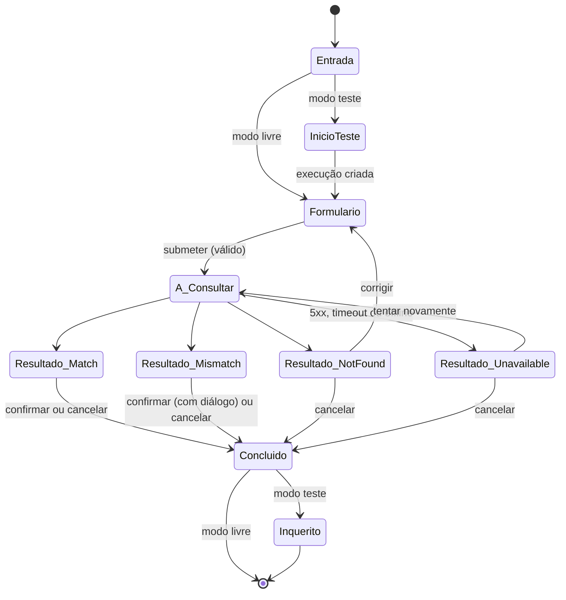
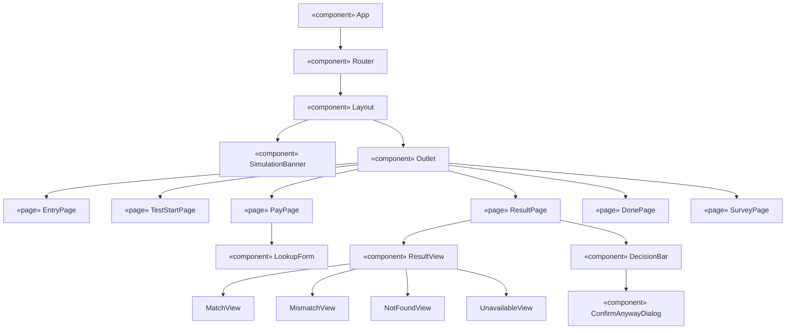
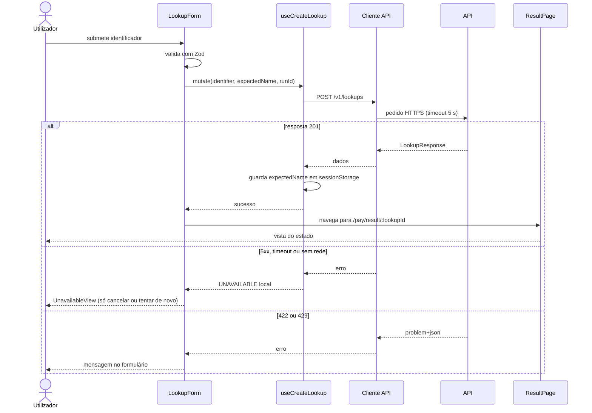

# 03 — Front-end (PWA)

← [Índice](00-indice.md) · [Arquitectura](01-arquitectura.md) · [Back-end](02-backend.md)

## 1. Stack e convenções

| Item | Escolha |
|---|---|
| Framework | React 18 + Vite + TypeScript (`strict`) |
| Estilos | Tailwind CSS com tokens semânticos (§9) |
| Rotas | React Router |
| Dados | TanStack Query (mutações e cache) |
| Formulários | React Hook Form + Zod |
| Cliente API | `openapi-typescript` + `openapi-fetch`, gerados de `apps/api/openapi.json` |
| PWA | `vite-plugin-pwa` (Workbox) |
| Testes | Vitest, Testing Library, MSW, Playwright, `@axe-core/playwright`, Lighthouse CI |
| Gestor de pacotes | `pnpm` |

Convenções:

- Organização por funcionalidade (*feature-based*); `shared/` só contém código sem lógica de negócio.
- Sem estado global; o estado de servidor vive no TanStack Query e o resto em estado local de componente.
- Textos de interface centralizados em `src/shared/i18n/pt.ts` (sem biblioteca de i18n na v1).
- `<html lang="pt-AO">` e `<meta name="robots" content="noindex">`.

## 2. Estrutura de pastas

```
apps/web/
├── public/                     # ícones PWA, favicon
├── src/
│   ├── app/                    # main.tsx, router.tsx, Layout, providers
│   ├── features/
│   │   ├── lookup/             # LookupForm, ResultPage, views por estado, DecisionBar, DonePage
│   │   ├── test-run/           # TestStartPage, SurveyPage
│   │   └── about/              # AboutPage
│   ├── shared/
│   │   ├── api/                # schema.d.ts (gerado), client.ts, errors.ts
│   │   ├── ui/                 # Button, Field, Banner, Dialog, StatusIcon
│   │   ├── i18n/               # pt.ts
│   │   └── lib/                # normalize.ts, session-storage.ts
│   └── test/                   # setup, handlers MSW
├── e2e/                        # Playwright
├── index.html
├── vite.config.ts
└── package.json
```

## 3. Rotas

| Rota | Ecrã | Notas |
|---|---|---|
| `/` | Entrada | Escolha entre "Modo livre" e "Iniciar teste" |
| `/test/start` | Início de teste | Facilitador indica `participant_code` e cenário; cria a execução |
| `/pay` | Formulário de transferência simulada | Em modo teste, pré-preenchido pelo cenário |
| `/pay/result/:lookupId` | Resultado | Carrega `GET /v1/lookups/:id`; mostra uma de quatro vistas |
| `/pay/done/:lookupId` | Conclusão | "Nenhum dinheiro foi movimentado" |
| `/test/survey/:runId` | Inquérito | Só em modo teste |
| `/about` | Sobre a simulação | Âmbito, limites, aviso de dados fictícios |
| `*` | 404 | — |

O `Layout` apresenta em todas as rotas o `SimulationBanner` (RF-09).

## 4. Fluxo de ecrãs



## 5. Componentes



`ResultView` escolhe a vista pelo `status`. `DecisionBar` renderiza apenas os botões presentes em `allowed_decisions`.

## 6. Estados de resultado

Cada estado tem ícone, cor semântica e texto próprios; a cor nunca é o único sinal.

| Estado | Título | Corpo | Acções |
|---|---|---|---|
| `MATCH` com comparação | Os dados coincidem | O nome associado a este identificador é **{nome}**. Instituição: {instituição}. | **Confirmar** (primária), Cancelar |
| `MATCH` sem comparação | Beneficiário encontrado | O nome associado é **{nome}**. Confirme se é o destinatário pretendido. | **Confirmar** (primária), Cancelar |
| `MISMATCH` | Atenção: os dados não coincidem | Esperado: **{esperado}**. Encontrado: **{nome}**. | **Cancelar** (primária), Confirmar mesmo assim (secundária, abre diálogo) |
| `NOT_FOUND` | Beneficiário não encontrado | Não existe registo para este identificador. Verifique-o e tente de novo. | **Voltar e corrigir** |
| `UNAVAILABLE` | Não foi possível consultar | Esta consulta falhou e **não é uma verificação**. Pode tentar novamente ou cancelar. | **Tentar novamente** (primária), Cancelar |

Aviso fixo nas vistas `MATCH`: "Coincidir o nome não garante que o pagamento seja seguro." (README §3, §7.)

Conclusão (`/pay/done`): "Simulação concluída. Nenhum dinheiro foi movimentado."

`ConfirmAnywayDialog`: texto "Os dados não coincidem. Tem a certeza de que quer confirmar?", botões "Voltar" (foco inicial) e "Confirmar mesmo assim".

## 7. Dados, erros e resiliência

### 7.1 Fluxo de consulta



### 7.2 Mapeamento de erros

| Situação | Comportamento da UI |
|---|---|
| `201` com `status` | Vista correspondente |
| `422 IDENTIFIER_FORMAT_INVALID` | Erro no campo; sem navegação |
| `429 RATE_LIMITED` | Mensagem "Demasiados pedidos. Aguarde um momento."; mantém o formulário |
| `5xx`, timeout de 5 s, falha de rede, offline | `UnavailableView` gerada no cliente; só "Tentar novamente" e "Cancelar"; **não existe "Confirmar"** |
| `409 DECISION_ALREADY_RECORDED` | Navega para a conclusão |
| `409 DECISION_NOT_ALLOWED` | Recarrega a consulta e mostra os botões permitidos |
| `404 LOOKUP_NOT_FOUND` | Mensagem e regresso ao formulário |

Regras:

- "Tentar novamente" cria uma nova consulta; nunca reutiliza o `lookup_id` anterior.
- Quando o `UNAVAILABLE` é local (sem `lookup_id`), "Cancelar" regressa ao formulário e não chama a API.
- O timeout do cliente (5 s) é superior ao do provider (2 s) para que o servidor responda `UNAVAILABLE` antes de o cliente desistir.

### 7.3 Cache e armazenamento

| Dado | Onde | Duração |
|---|---|---|
| Consulta (`lookup`) | TanStack Query, chave `["lookup", id]` | `staleTime` 0; refeita ao recarregar |
| `expected_name` | `sessionStorage`, chave `cp:expected:{lookupId}` | Sessão do separador |
| `run_id`, cenário | `sessionStorage`, chave `cp:run` | Sessão do separador |
| Respostas `/v1/*` | Service Worker | Nunca em cache |

## 8. Validação

```ts
import { z } from "zod";

export const identifierSchema = z
  .string()
  .trim()
  .toUpperCase()
  .regex(/^DEMO-\d{4}$/, "Use um identificador de demonstração, por exemplo DEMO-1001.");

export const lookupFormSchema = z.object({
  identifier: identifierSchema,
  expectedName: z
    .string()
    .trim()
    .max(120, "Máximo de 120 caracteres.")
    .optional()
    .transform((v) => (v ? v : undefined)),
});
```

O formulário mostra a nota: "Introduza apenas identificadores de demonstração. Não use dados reais."

## 9. Design e acessibilidade

### 9.1 Tokens

| Token | Uso |
|---|---|
| `--state-match` | Vista `MATCH` |
| `--state-mismatch` | Vista `MISMATCH` |
| `--state-notfound` | Vista `NOT_FOUND` |
| `--state-unavailable` | Vista `UNAVAILABLE` |
| `--banner-sim` | Banner de simulação |
| `--text`, `--bg`, `--border`, `--focus` | Base |

Os valores de cor são definidos no Figma e validados com contraste ≥ 4,5:1 (texto) e ≥ 3:1 (ícones e bordas).

### 9.2 Ícone e rótulo por estado

| Estado | Ícone | Rótulo para leitores de ecrã |
|---|---|---|
| `MATCH` | Visto | "Dados coincidem" |
| `MISMATCH` | Triângulo de aviso | "Dados não coincidem" |
| `NOT_FOUND` | Lupa com cruz | "Beneficiário não encontrado" |
| `UNAVAILABLE` | Nuvem cortada | "Consulta indisponível" |

### 9.3 Regras de acessibilidade (NFR-04)

- Região de resultado com `role="status"` e `aria-live="polite"`.
- Ao mudar de rota, o foco vai para o `h1` da página (`tabIndex={-1}`).
- Erros de campo ligados por `aria-describedby`; campos com `<label>` visível.
- Alvos de toque ≥ 44 × 44 px; tamanho de texto base 16 px.
- Respeitar `prefers-reduced-motion`.
- Banner de simulação com texto ("DEMONSTRAÇÃO — dados fictícios, nenhum dinheiro é movimentado"), não apenas cor.
- Navegação completa por teclado; diálogo com *focus trap* e fecho por `Esc`.

## 10. PWA

| Item | Configuração |
|---|---|
| Plugin | `vite-plugin-pwa`, estratégia `generateSW` |
| Registo | `registerType: "prompt"`; mostra "Nova versão disponível. Actualizar" |
| Manifest | `name: "ConfirmaPay (Demo)"`, `short_name: "ConfirmaPay"`, `display: "standalone"`, `start_url: "/"`, `lang: "pt-AO"`, ícones 192, 512 e *maskable* |
| Pré-cache | Shell da aplicação (HTML, JS, CSS, ícones, fontes locais) |
| Runtime | `/v1/*` com `NetworkOnly`; sem *fallback* para cache |
| Offline | Shell abre; submeter consulta resulta em `UnavailableView`; banner "Sem ligação" visível |
| Ícones e nome | Provisórios (Q-05); não imitar marcas reais |

## 11. Testes do front-end

| Nível | Ferramenta | Âmbito |
|---|---|---|
| Unitário | Vitest | Schema Zod, normalização, mapeamento de erros, selecção de vista por estado |
| Componente | Testing Library + MSW | Cada vista de estado; `DecisionBar` por `allowed_decisions`; diálogo de confirmação |
| E2E | Playwright | Cenários `SC-01` a `SC-06` contra a API real em Docker Compose |
| Acessibilidade | `@axe-core/playwright` | Quatro estados, formulário, conclusão |
| PWA / desempenho | Lighthouse CI | Mobile ≥ 90 (NFR-05) |

Casos detalhados em [05](05-testes-e-metricas.md).
