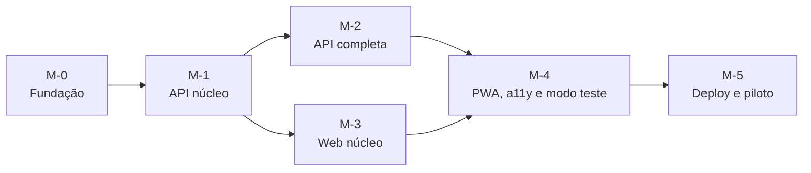

# 06 — Backlog e marcos

← [Índice](00-indice.md)

Dimensão relativa: **S** (pequena), **M** (média), **L** (grande). Sem estimativas em dias até se conhecer a disponibilidade da equipa.

## 1. Marcos

| Marco | Entregas | Dim. | Critério de saída |
|---|---|---|---|
| **M-0 Fundação** | Monorepo, `main` protegido, Compose, Makefile, lint e tipos, `ci-api` e `ci-web` com testes mínimos | M | CI verde numa PR vazia; `make up` arranca API e BD |
| **M-1 API núcleo** | Modelos e migrações, seed, `BeneficiaryProvider` + `SimulatedProvider`, `POST` e `GET /v1/lookups`, erros `problem+json`, `request_id`, `/v1/health`, `openapi.json` | L | TC-02 a TC-08, TC-16, TC-19, TC-23 passam |
| **M-2 API completa** | Decisões, `scenarios`, `test-runs`, inquérito, métricas e CSV, rate limit, CORS, cabeçalhos, logs sem corpos | M | TC-10, TC-11, TC-15, TC-20, TC-21, TC-22 passam |
| **M-3 Web núcleo** | Tokens e componentes base, rotas, `LookupForm`, quatro vistas de estado, `DecisionBar`, diálogo, conclusão, cliente gerado, MSW | L | Testes de componente para os 4 estados; TC-01, TC-12 passam |
| **M-4 PWA, a11y e modo teste** | `vite-plugin-pwa`, offline, modo teste (início e inquérito), banner, `AboutPage`, axe, Lighthouse | M | TC-09, TC-14, TC-17, TC-18 passam |
| **M-5 Deploy e piloto** | Vercel e Render, `deploy` e smoke test, `vercel.json`, monitor, runbook testado, E2E `SC-01` a `SC-06`, ensaio com 2–3 pessoas | M | Critérios de aceitação da v1 (05 §7); decisões Q-01 a Q-06 fechadas |

## 2. Tarefas por marco

### M-0 Fundação
- [ ] Criar repositório, `README.md` e `docs/technical/`
- [ ] Estrutura `apps/api`, `apps/web` com `uv` e `pnpm`
- [ ] `docker-compose.yml`, `Dockerfile`, `Makefile`
- [ ] Ruff, mypy, ESLint, Prettier, `pre-commit`
- [ ] Workflows `ci-api` e `ci-web`
- [ ] Protecção do ramo `main`

### M-1 API núcleo
- [ ] Configuração (`pydantic-settings`), logging, `request_id`
- [ ] Modelos SQLAlchemy e migração inicial com restrições (02 §2)
- [ ] Seed idempotente (02 §10)
- [ ] `domain/`: normalização de nomes, máscara, estados
- [ ] Provider: protocolo, simulado, suite de contrato
- [ ] `LookupService` com timeout
- [ ] Routers `lookups` e `health`; handler global de erros
- [ ] Export de `openapi.json` e verificação no CI

### M-2 API completa
- [ ] `POST /decision` com regras 4.4
- [ ] `scenarios.py`, `GET /v1/scenarios`, `POST /v1/test-runs`
- [ ] `POST /v1/test-runs/:id/survey`
- [ ] `MetricsService`, `/v1/admin/metrics`, `/v1/admin/export.csv`
- [ ] Rate limit, CORS, cabeçalhos, chave de administração
- [ ] Teste de carga local (TC-22)

### M-3 Web núcleo
- [ ] Ecrãs no Figma (formulário, 4 estados, conclusão, inquérito)
- [ ] Tokens, `Button`, `Field`, `Banner`, `Dialog`, `StatusIcon`
- [ ] `pnpm gen:api`, cliente, tratamento de erros (03 §7.2)
- [ ] `LookupForm` + Zod
- [ ] `ResultPage`, quatro vistas, `DecisionBar`, `ConfirmAnywayDialog`
- [ ] `DonePage`
- [ ] Testes de componente com MSW

### M-4 PWA, a11y e modo teste
- [ ] Manifest, ícones provisórios, Service Worker, aviso de nova versão
- [ ] Estado offline e banner "Sem ligação"
- [ ] `TestStartPage`, `SurveyPage`, pré-preenchimento por cenário
- [ ] `AboutPage`
- [ ] axe e Lighthouse no CI

### M-5 Deploy e piloto
- [ ] Projectos Vercel e Render; variáveis (04 §4)
- [ ] Workflow `deploy` e smoke test
- [ ] `vercel.json` com CSP final
- [ ] Monitor externo
- [ ] E2E dos seis cenários
- [ ] Ensaio piloto e ajustes

## 3. Riscos

| ID | Risco | Mitigação |
|---|---|---|
| R-01 | Utilizadores acharem que é um serviço real | Banner permanente, `is_simulation`, página "Sobre", dados claramente fictícios |
| R-02 | Participante introduzir dados reais | Regex `DEMO-NNNN` no cliente e na API; nomes não persistidos |
| R-03 | Interpretar `MATCH` como garantia de segurança | Aviso fixo; `SC-06`; pergunta de inquérito `match_implies_safe` |
| R-04 | Falha de consulta confundida com verificação | ADR-05; `UnavailableView` sem "Confirmar"; TC-09, TC-11 |
| R-05 | Contrato front/back divergir | OpenAPI versionado e verificado no CI (NFR-09) |
| R-06 | Latência elevada a partir de Angola | Região UE; shell em CDN; medir no piloto e reavaliar a região |
| R-07 | Interpretar resultados como prova de redução de fraude | Regras de reporte (05 §6); indicar n |
| R-08 | Conclusões sobre a EMIS sem verificação | Manter README §5.3 e §11 como "por validar"; nada neste projecto afirma falhas do sistema actual |

## 4. Definição de pronto (DoD)

Uma tarefa está pronta quando:

1. O código cumpre lint, tipos e testes no CI.
2. Os testes relevantes (05) existem e passam.
3. Alterações de contrato incluem `openapi.json` e tipos regenerados.
4. Alterações de comportamento actualizam a documentação em `docs/technical/`.
5. Nenhum dado pessoal real é recolhido, registado ou guardado.
6. A PR foi revista e integrada em `main`.

## 5. Decisões necessárias antes de M-0 e M-5

| ID | Decisão | Necessária antes de |
|---|---|---|
| Q-02 | Hosting | M-5 (conta e variáveis) |
| Q-03 | Nomes fictícios | M-1 (seed) |
| Q-05 | Nome e ícones | M-4 |
| Q-06 | Domínio | M-5 |
| Q-01 | Variante de controlo | M-4 (se aprovada, acrescenta tarefas ao modo teste) |
| Q-04 | Amostra e alvos | M-5 (piloto) |
